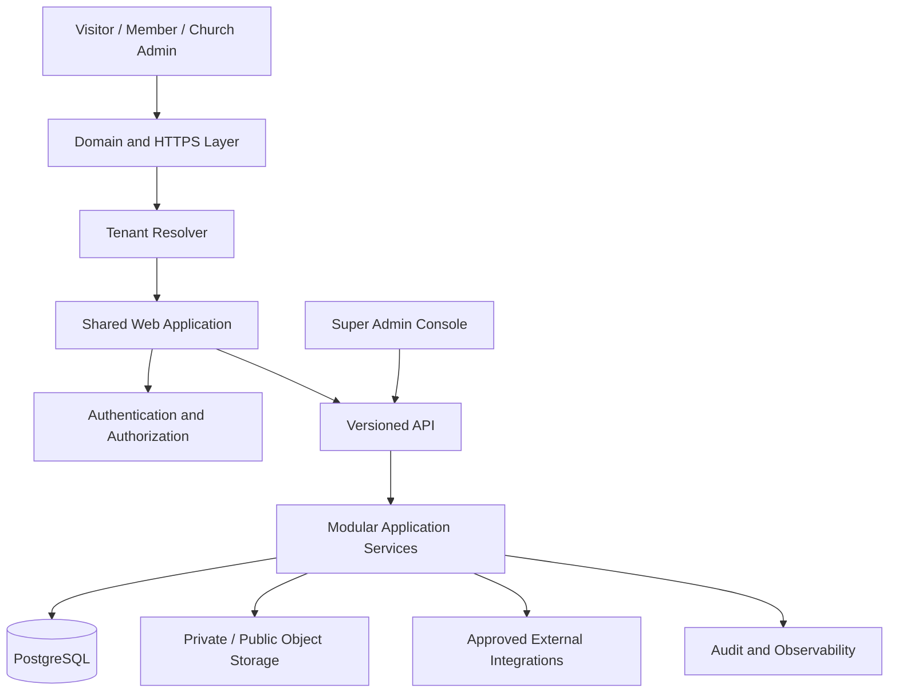

# Multi-Tenant Church Platform — Technical Architecture Blueprint

**Status:** Architecture baseline approved for planning  
**Repository:** `eswar-band/gospel-of-peace-community`  
**Base:** `phase-2-functional-website`  
**Implementation branch:** `feature/multi-tenant-architecture`  
**Document type:** Design blueprint — not a production implementation

---

## 1. Executive summary

Build one shared church-platform product that can host multiple independent churches (tenants). Each church receives its own domain, branding, content, enabled features, members and administration while using shared application code and infrastructure.

The initial architecture is a **modular monolith** with a tenant-aware backend and PostgreSQL database. This is simpler to build, test, deploy and operate than microservices at the current stage. Modules should have clear boundaries so that high-scale components can be extracted later if evidence justifies it.

### Approved product decisions

| Area | Decision |
|---|---|
| Design strategy | Hybrid: reusable themes and layouts plus controlled custom design packages |
| Initial themes | Modern, Classic and Editorial / Mission-focused |
| Design authority | Super Admin controls the design system and assigns/publishes designs |
| Roles | Super Admin, Church Admin and Member |
| Existing content | Church Admin can edit, preview, publish and unpublish without Super Admin approval |
| New page templates | Church Admin submits a request; Super Admin reviews and provides/authorizes the template |
| New features | Church Admin submits a request; Super Admin evaluates, prioritizes and manages platform delivery |
| Initial charity scope | Reusable static information pages with dynamic content managed by Church Admin |
| Data isolation | Tenant-scoped authorization plus PostgreSQL Row-Level Security (RLS) as defense in depth |

These decisions are the baseline for the first release. Any later change should be recorded as an architecture decision rather than silently changing the rules.

---

## 2. Current project baseline and boundary

The current Phase 2 branch is a static HTML, CSS and JavaScript front-end prototype. The repository README explicitly identifies the backend, database, admin dashboard and secure authentication as future work.

Therefore:
- Keep the current public website working while backend foundations are designed.
- Do not treat demo login, sample content or browser-side settings as production security.
- Do not put database credentials, API secrets, private file URLs or authorization rules in browser JavaScript.
- Introduce the backend and tenant model in separate, reviewable phases.
- This document does not claim that a backend, PostgreSQL schema, RLS policies or production authentication already exist.

---

## 3. High-level architecture



### Main layers

1. **Domain layer:** maps a verified hostname to an active tenant.
2. **Presentation layer:** shared website templates, admin console and theme renderer.
3. **Identity and access layer:** authentication, platform role checks, tenant membership and permissions.
4. **Application layer:** content, events, members, prayer, media, charity pages, requests and integrations.
5. **Data layer:** PostgreSQL with tenant ownership and RLS.
6. **Asset layer:** object storage for uploaded images and documents.
7. **Operations layer:** audit logs, monitoring, backups, migrations and deployment.

### Recommended initial technology direction

- **Frontend:** retain the current HTML/CSS/JavaScript during the first integration stage; progressively introduce reusable components where useful.
- **Backend:** Node.js with TypeScript and a modular REST API.
- **Database:** PostgreSQL.
- **API style:** versioned REST endpoints, initially `/api/v1`.
- **File storage:** S3-compatible object storage; store object keys and metadata in PostgreSQL.
- **Authentication:** secure server-managed sessions using HttpOnly, Secure and appropriate SameSite cookies. Use a mature identity library/provider rather than writing authentication primitives from scratch.
- **Deployment:** separate frontend and API services if needed, with managed PostgreSQL and object storage. Keep secrets in the deployment secret manager.

The backend should start as a **modular monolith**, not a microservice fleet.

---

## 4. Tenant identity and domain resolution

Every request must resolve to exactly one tenant before tenant-owned data is read or changed.

### Resolution flow

1. Read the request hostname.
2. Normalize it and look up an active, verified record in `tenant_domains`.
3. Resolve the associated `tenant_id`.
4. Attach the tenant context to the server-side request context.
5. Authenticate the user.
6. Verify the user's platform role or membership in that tenant.
7. Apply tenant scope to every query and write.
8. Reject unknown, unverified, suspended or inactive tenant domains.

Support both platform-provided subdomains (for example, `church.platform.example`) and verified custom domains (for example, `www.church-example.org`).

**Never trust a client-supplied `tenant_id` as proof of access.** The server derives tenant identity from the verified hostname and authenticated membership. Administrative cross-tenant operations require explicit Super Admin authorization and must be audited.

### Domain safeguards

- Verify custom-domain ownership before activation.
- Enforce unique normalized hostnames.
- Support domain verification and TLS provisioning lifecycle states.
- Keep a canonical domain and redirect policy per tenant.
- Do not allow a suspended tenant to serve private or administrative content.

---

## 5. Roles and authorization

The product exposes exactly three roles initially.

### 5.1 Super Admin — platform scope

Responsibilities:
- Create, activate, suspend and configure tenants.
- Manage domain mappings and platform-wide settings.
- Create, version and assign themes and page templates.
- Manage feature availability and platform releases.
- Review new-page and new-feature requests.
- Manage platform support and operational settings.
- View cross-tenant operational reports where authorized.

Super Admin access is powerful. Require MFA, strong session controls, audit logging and least-privilege operational practices.

### 5.2 Church Admin — one tenant scope at a time

Responsibilities:
- Manage that church's profile, contact information and public content.
- Edit, preview, publish and unpublish content on existing approved page templates without Super Admin approval.
- Manage the church's events, media, gallery, testimonies, publications and enabled initiatives.
- Manage church members and permitted submissions.
- Submit requests for new page templates or new features.
- View reports for their own church.

Church Admin cannot:
- Read or modify another tenant's data.
- Create or change global themes or shared feature code.
- Activate a feature that the platform has not made available to that tenant.
- Bypass privacy controls for sensitive records.

### 5.3 Member — tenant scope

Responsibilities:
- Manage their own permitted profile fields.
- View public and authorized member-only content.
- Use enabled member features such as event registration or volunteer interest forms.
- Submit permitted requests and view their own submissions.

### 5.4 Permission model

Keep the three roles as the user-facing role model, but implement permissions internally so the platform can grow without inventing new roles.

Example permission keys:

- `tenant.manage`
- `tenant.members.manage`
- `content.read`
- `content.manage_existing_pages`
- `content.publish`
- `media.manage`
- `events.manage`
- `initiatives.manage`
- `requests.submit`
- `themes.manage_global`
- `features.manage_global`
- `audit.read_tenant`

Permissions are assigned by trusted server-side policy. Church Admin permissions are always tenant-scoped. Do not rely on hiding buttons in the browser.

### 5.5 Authorization decision order

For every protected request:

1. Validate the session/token.
2. Resolve the tenant from the verified host.
3. Confirm the user is active.
4. Check Super Admin platform authority or active membership in the resolved tenant.
5. Check the required permission.
6. Check record ownership / tenant scope.
7. Apply any record-level privacy restrictions.
8. Write an audit event for sensitive changes.

A user may have memberships in more than one church. The active tenant context must be explicit and independently authorized for each request.

---

## 6. Theme, layout and custom design system

### 6.1 Initial theme catalogue

1. **Modern:** clean, spacious, contemporary layout.
2. **Classic:** traditional visual language and familiar church navigation.
3. **Editorial / Mission-focused:** strong storytelling, photography and community-impact sections.

Three themes are the launch catalogue, not a permanent limit.

### 6.2 Separate theme from tenant branding

A theme defines reusable design tokens and components. Tenant branding supplies values such as:
- Logo and favicon.
- Brand and accent colors.
- Font selections from an approved set.
- Background and image treatments.
- Contact identity and footer details.

A tenant configuration selects a theme version and supplies its branding values. This allows many tenants to share one theme while retaining their own identity.

### 6.3 Layout configuration

Store page composition as validated configuration, not executable code. A page configuration may specify:
- Approved template identifier.
- Ordered section identifiers.
- Enabled/disabled sections.
- Supported layout variants.
- Tenant content references.

Do not permit arbitrary JavaScript, arbitrary HTML or unrestricted CSS from tenant administrators.

### 6.4 Custom design packages

When the three themes and supported layout options are insufficient:
1. Church Admin submits a design request.
2. Super Admin assesses the requirement.
3. Platform design/development creates or selects a reusable package.
4. Package is versioned and tested against the component contract.
5. Super Admin assigns and publishes the package for the tenant.
6. A previous compatible version remains available for rollback.

Custom design packages may change presentation; they must not duplicate authentication, tenant isolation, business rules or shared module logic.

### 6.5 Publishing and rollback

- Validate a design configuration before publishing.
- Preview it in a staging/preview context.
- Record who published it and when.
- Store immutable revision identifiers.
- Support rollback to a known compatible revision.
- Keep a safe default theme if a tenant's custom package fails validation.

---

## 7. Content management: static templates, dynamic content

The initial approach is **static page templates with dynamic, database-backed content**.

The platform owns the structure and layout. Church Admin edits the content fields supported by the existing template.

### Example: charity and outreach pages

Initial initiatives can be represented using reusable content templates:
- Children's Home.
- Old-Age Home.
- Charity Hospital.
- Free Education.
- General Charity / Community Outreach.

For the first release these are informational pages, not full operational management systems. Church Admin can update:
- Page title and introduction.
- Mission and objectives.
- Public service descriptions.
- Public timings and contact information.
- Approved photographs and captions.
- Public impact stories and updates.
- Published/unpublished state.

The platform supplies the page layout and permitted content fields. A Church Admin cannot create an arbitrary new page type or add new application logic.

### Content workflow

**Existing page**
1. Church Admin edits content.
2. Server validates the fields and uploaded media.
3. Admin previews the page.
4. Admin publishes directly — no Super Admin approval.
5. Previous published versions remain available for restoration.

**New page template**
1. Church Admin submits a request.
2. Super Admin reviews the purpose and reuse potential.
3. Super Admin creates or authorizes the template.
4. The template is enabled for the tenant.
5. Church Admin manages its content.

**New feature**
1. Church Admin submits a feature request.
2. Super Admin reviews impact, privacy, security, cost and reuse potential.
3. The feature is prioritized and developed as a shared module or approved tenant-specific capability.
4. It is tested and released.
5. Super Admin enables it for selected tenants.

### Content safety

- Validate and sanitize rich text on the server.
- Allow only approved content block types.
- Validate image MIME type, size and dimensions.
- Keep private uploads private and use short-lived signed access URLs.
- Obtain appropriate consent before publishing identifiable people, especially children and vulnerable adults.
- Do not store medical records, children's case files or other highly sensitive records in the general public CMS.

---

## 8. Feature registry and modular feature architecture

A central feature registry describes platform capabilities and controls which tenants can use them.

Each feature definition should include:
- Stable feature key and display name.
- Description and version.
- Dependencies.
- Availability status.
- Required permissions.
- Configuration schema version.
- Data classification / sensitivity.
- Tenant enablement state.

### Initial feature candidates

- Core website pages and content management.
- Events and calendar.
- Media and livestream links.
- Testimonies and gallery.
- Books and publications.
- Prayer request intake.
- Community & Outreach informational pages.
- Member profiles.

### Future modules

- Donations and receipts.
- Children's sponsorship.
- Volunteer management.
- Education enrollment and student administration.
- Hospital appointments and healthcare workflows.
- Old-age-home resident and care operations.

Future operational modules should be designed separately from informational pages. For example, publishing a hospital services page is not the same as managing patient records. Healthcare and child-protection workflows require separate security, consent, access, retention and legal review before implementation.

A tenant can only enable a feature that is globally registered, released and explicitly enabled for that tenant. The frontend feature flag is for presentation only; the backend must enforce availability and permissions.

---

## 9. Feature and page request workflow

Provide a **Requests** area in the Church Admin dashboard.

### Request categories

- New page template.
- New platform feature.
- Custom design / layout.
- Integration request.

### Request fields

- Request title.
- Category.
- Description and business purpose.
- Expected users / audience.
- Supporting attachments.
- Submitted by and submitted date.
- Status and status history.
- Super Admin comments.

### Suggested statuses

`Submitted → Under Review → Approved → In Development → Ready for Tenant → Completed`

A request may also be `Rejected` or `On Hold`, with a reason. Request status does not automatically grant access to an unreleased feature.

---

## 10. Logical PostgreSQL data model

This is a logical schema blueprint, not an executable migration. Exact column types, indexes, constraints and RLS policies must be reviewed and tested before production.

### 10.1 Identity and tenancy

| Table | Important fields | Purpose |
|---|---|---|
| `tenants` | id, name, slug, status, created_at | One church / tenant |
| `tenant_domains` | id, tenant_id, hostname, is_primary, verification_status | Verified subdomain and custom-domain mapping |
| `users` | id, email, password_hash / identity_provider_id, status | Global user identity |
| `platform_user_roles` | user_id, role_key | Platform-level Super Admin assignment |
| `tenant_memberships` | id, tenant_id, user_id, role_key, status | Church Admin / Member membership |
| `user_sessions` | id, user_id, expires_at, revoked_at | Server-managed session lifecycle |

Use unique constraints for normalized email and hostname as appropriate. A user may have memberships in multiple tenants, but each membership must have an explicit tenant.

### 10.2 Design and configuration

| Table | Important fields | Purpose |
|---|---|---|
| `theme_registry` | id, theme_key, version, status, manifest | Available versioned themes |
| `tenant_branding` | tenant_id, logo_asset_id, color_tokens, typography_tokens | Tenant brand settings |
| `tenant_design_assignments` | tenant_id, theme_id, package_version, status | Active design assignment |
| `page_template_registry` | id, template_key, version, schema | Approved reusable page templates |
| `tenant_page_configs` | id, tenant_id, page_key, template_id, layout_config, version | Tenant page composition |
| `design_revisions` | id, tenant_id, revision_type, snapshot, created_by | Design history and rollback |

Theme and template manifests must be schema-validated. Do not execute tenant-supplied code.

### 10.3 Content and media

| Table | Important fields | Purpose |
|---|---|---|
| `content_pages` | id, tenant_id, page_key, slug, title, status, published_at | Tenant page content |
| `content_sections` | id, tenant_id, page_id, section_key, block_type, content_json, sort_order | Typed page content blocks |
| `content_revisions` | id, tenant_id, page_id, revision_no, snapshot, created_by | Content history |
| `media_assets` | id, tenant_id, storage_key, mime_type, visibility, metadata | Uploaded images/files |
| `content_media_links` | tenant_id, content_section_id, media_asset_id | Content-to-media relationships |

Use typed content blocks with a versioned schema. Avoid storing executable HTML/JavaScript in `content_json`.

### 10.4 Feature registry and requests

| Table | Important fields | Purpose |
|---|---|---|
| `feature_registry` | id, feature_key, version, status, manifest | Global catalogue of features |
| `tenant_features` | tenant_id, feature_id, enabled, config_json | Tenant feature availability |
| `page_feature_requests` | id, tenant_id, request_type, title, description, status | New page/feature/design requests |
| `request_comments` | id, request_id, author_id, comment, created_at | Request discussion and decisions |
| `request_status_history` | id, request_id, old_status, new_status, changed_by | Traceable request lifecycle |

### 10.5 Existing and future module data

All tenant-owned module records must include `tenant_id`. Examples include:
- `events`
- `testimonies`
- `gallery_items`
- `publications`
- `prayer_requests`
- `initiative_programs`

The first charity release can store informational content through the generic CMS. Add dedicated tables only when real workflows are approved, such as sponsorship payments, student enrollment or patient appointments.

### 10.6 Audit and operations

| Table | Important fields | Purpose |
|---|---|---|
| `audit_logs` | id, tenant_id nullable, actor_user_id, action, resource_type, resource_id, metadata, created_at | Security and administrative audit trail |
| `integration_connections` | id, tenant_id, provider, status, secret_reference | Tenant integration metadata; secrets live in a secret manager |
| `webhook_events` | id, tenant_id, provider, event_id, status, received_at | Reliable integration processing |

Audit logs should be append-only to ordinary application roles. Avoid putting passwords, access tokens, medical details or private prayer text in audit metadata.

---

## 11. Tenant isolation and database security

Tenant isolation is a release-blocking requirement.

### Required controls

1. Add `tenant_id` to every tenant-owned table.
2. Scope every tenant query by the server-resolved tenant context.
3. Use composite unique keys and foreign keys where needed to prevent cross-tenant relationships.
4. Enable PostgreSQL RLS on tenant-owned tables.
5. Set tenant context transaction-locally for each database transaction.
6. Use a non-owner application database role that does not bypass RLS.
7. Ensure connection pooling cannot leak tenant context between requests.
8. Keep Super Admin cross-tenant operations explicit, limited and audited.
9. Test direct API calls, background jobs, exports, search, file access and webhook processing for tenant isolation.
10. Back up and restore data with tenant boundaries and recovery requirements understood.

RLS is defense in depth, not a substitute for application authorization. Policies must fail closed when tenant context is missing.

### Sensitive data

- Public CMS content is separate from private member and request data.
- Prayer requests may be confidential and require restricted access.
- Children and vulnerable-person records require strict minimization and consent controls.
- Healthcare records must not be added to the general CMS or ordinary member profile tables.
- Apply retention and deletion policies based on data type and applicable law.

---

## 12. API boundary proposal

Use a versioned API. These are proposed routes, not implemented endpoints.

### Public / tenant website

- `GET /api/v1/public/site` — published tenant site configuration.
- `GET /api/v1/public/pages/:slug` — published page content.
- `GET /api/v1/public/events` — public events.
- `GET /api/v1/public/media` — public media items.

### Authentication and member

- `POST /api/v1/auth/login`
- `POST /api/v1/auth/logout`
- `GET /api/v1/auth/me`
- `GET /api/v1/member/profile`
- `PATCH /api/v1/member/profile`

### Church Admin

- `GET /api/v1/admin/content/pages`
- `POST /api/v1/admin/content/pages`
- `PATCH /api/v1/admin/content/pages/:id`
- `POST /api/v1/admin/content/pages/:id/publish`
- `POST /api/v1/admin/content/pages/:id/restore/:revisionId`
- `POST /api/v1/admin/media`
- `GET /api/v1/admin/features`
- `POST /api/v1/admin/requests`
- `GET /api/v1/admin/requests`

### Super Admin

- `/api/v1/platform/tenants`
- `/api/v1/platform/themes`
- `/api/v1/platform/page-templates`
- `/api/v1/platform/features`
- `/api/v1/platform/requests`

All tenant-specific routes derive and verify tenant context server-side. The API must not accept a tenant identifier from the browser as authorization. Validate input, paginate list endpoints, rate-limit sensitive actions and return only fields the caller is allowed to see.

---

## 13. Suggested repository evolution

Keep the existing static site intact during the initial architecture phase. Introduce the backend in a clearly separated structure when implementation is approved.

```text
/
├── index.html
├── media.html
├── events.html
├── testimonies.html
├── gallery.html
├── books.html
├── styles.css
├── app.js
├── docs/
│   └── architecture/
│       └── multi-tenant-platform-blueprint.md
└── platform/                     # future implementation
    ├── apps/
    │   ├── web/                  # shared public website
    │   ├── admin/                # Super Admin and Church Admin UI
    │   └── api/                  # versioned REST API
    ├── packages/
    │   ├── auth/
    │   ├── tenant-context/
    │   ├── authorization/
    │   ├── design-system/
    │   ├── content-engine/
    │   └── shared-contracts/
    ├── modules/
    │   ├── tenants/
    │   ├── content/
    │   ├── media/
    │   ├── events/
    │   ├── prayer/
    │   ├── outreach/
    │   └── requests/
    ├── database/
    │   ├── migrations/
    │   ├── seeds/
    │   └── policies/
    └── tests/
        ├── unit/
        ├── integration/
        ├── authorization/
        └── tenant-isolation/
```

This is a target structure, not a requirement to move all current files immediately. Avoid a large-bang rewrite.

---

## 14. Phased implementation roadmap

### Phase 0 — Architecture and product contracts
- Approve the tenant lifecycle and domain model.
- Finalize role/permission matrix.
- Define theme, page-template and content-block manifests.
- Define data classification and privacy requirements.
- Confirm hosting, storage, email and identity-provider choices.

**Exit criteria:** reviewed architecture, API contracts and schema design.

### Phase 1 — Backend and tenant foundation
- Create backend application and deployment pipeline.
- Create PostgreSQL migrations.
- Implement tenant, domain, user and membership models.
- Implement tenant resolution and secure authentication.
- Implement authorization middleware and RLS.
- Add audit logging and automated tenant-isolation tests.

**Exit criteria:** two test tenants cannot access each other's records through any tested API or database path.

### Phase 2 — Theme and page-template engine
- Implement theme registry and three initial themes.
- Implement tenant branding and design assignment.
- Implement approved page-template registry.
- Implement safe page composition and preview.
- Implement design versioning and rollback.

**Exit criteria:** two tenants can use different themes and branding on the shared application without code duplication.

### Phase 3 — CMS and admin dashboards
- Build Super Admin tenant and design management.
- Build Church Admin content management.
- Implement media upload and validation.
- Implement direct publishing for existing templates.
- Implement content revisions and restore.
- Implement page/feature/design request workflows.

**Exit criteria:** Church Admin can safely update existing pages without Super Admin approval, while new page templates remain controlled by Super Admin.

### Phase 4 — Migrate existing website modules
- Connect events, media, testimonies, gallery, books and prayer flows to tenant-aware APIs.
- Replace sample content with approved tenant content.
- Preserve current public website behavior during migration.
- Add per-tenant feature enablement.

**Exit criteria:** each module works within tenant scope and disabled features cannot be accessed through the API.

### Phase 5 — Outreach informational pages
- Add reusable templates for Children's Home, Old-Age Home, Charity Hospital, Free Education and General Outreach.
- Enable Church Admin content editing.
- Add media consent and privacy review.
- Keep sensitive operational records out of the generic CMS.

**Exit criteria:** each tenant can publish its own permitted outreach information without custom code.

### Phase 6 — Production readiness and onboarding
- Security review and penetration testing.
- Accessibility, responsive and performance testing.
- Backup/restore and disaster-recovery exercise.
- Domain verification and TLS automation.
- Monitoring, alerting and operational runbooks.
- Tenant onboarding and offboarding procedures.

**Exit criteria:** production launch checklist is signed off and recovery/isolation tests pass.

### Future modules — separate product decisions
Donations, sponsorship, student administration, hospital workflows and care-home operations should each receive their own requirements, threat model, privacy review and module design before implementation.

---

## 15. Testing and acceptance criteria

The platform is not ready for production until these checks pass:

### Tenant isolation
- Tenant A cannot read, update, delete or enumerate Tenant B data.
- Tenant A cannot access Tenant B media through guessed object keys or URLs.
- Search, exports, background jobs and webhooks preserve tenant scope.
- Missing tenant context fails closed.
- Cross-tenant foreign-key relationships are rejected.

### Roles
- Super Admin can perform authorized platform operations and all such actions are audited.
- Church Admin can manage only their tenant.
- Member can access only permitted member functions and their own private records.
- Direct API calls cannot bypass UI restrictions.

### Content and design
- Existing page content can be published by Church Admin without Super Admin approval.
- New page templates are unavailable until Super Admin authorizes them.
- New features remain unavailable until released and enabled for the tenant.
- Invalid content blocks and unsafe uploads are rejected.
- Content and design revisions can be restored.

### Reliability and privacy
- Tenant domain resolution rejects unverified domains.
- Sessions are revoked correctly.
- Sensitive fields are not exposed in public APIs, logs or analytics.
- Backups can be restored and verified.
- Consent and retention policies are documented for sensitive content.

---

## 16. Decisions still required before production implementation

These are not blockers for the blueprint, but they should be confirmed before building the corresponding systems:

1. **Hosting:** where the API, PostgreSQL and object storage will run.
2. **Identity:** local email/password, external identity provider, or both; MFA policy for Super Admin.
3. **Tenant billing:** whether subscriptions and plan limits are in the first release.
4. **Custom domains:** whether each tenant gets a platform subdomain, a custom domain, or both.
5. **Content languages:** initial supported languages and translation workflow.
6. **Data residency and compliance:** applicable privacy, child-protection, healthcare and financial requirements for operating locations.
7. **File limits:** allowed media formats, upload sizes and retention.

---

## 17. Architecture principles to preserve

1. One shared platform; no separate application copy per church.
2. Tenant identity is resolved and enforced server-side.
3. Three user-facing roles, with granular internal permissions.
4. Church Admin independently publishes content on existing approved templates.
5. Super Admin controls new templates, global features and design packages.
6. Themes and page layouts are configuration-driven and versioned.
7. Generic CMS content is not a substitute for secure healthcare, child-protection or financial systems.
8. Prefer a modular monolith until measured scale justifies service extraction.
9. Security, privacy, accessibility and tenant isolation are release requirements, not later enhancements.
10. Migrate the existing website incrementally; avoid a disruptive rewrite.

**End of blueprint.**
